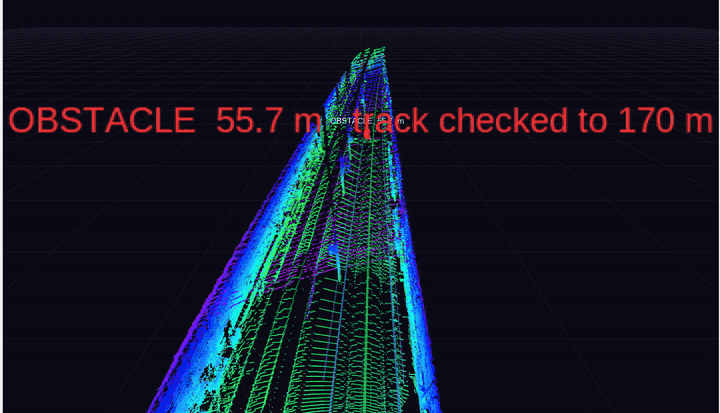
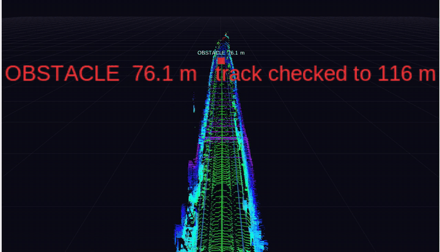
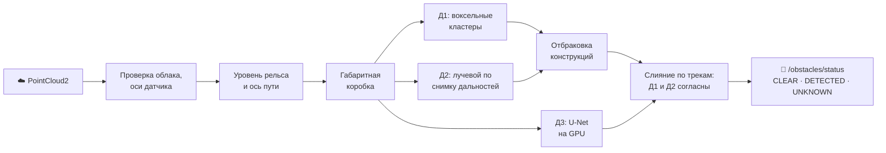

<div align="center">

# 🚇 I.MOSCOW

### Обнаружение посторонних объектов перед беспилотным поездом в тоннеле метро по данным 3D-лидара


Строит модель *нормального* тоннеля и сообщает обо всём, что оказалось в габарите поезда и не похоже
на тоннель. Три детектора — кластеры точек (Д1), лучевой по снимку дальностей (Д2) и нейросеть U-Net
на GPU (Д3) — и подтверждение во времени: объект сообщается, когда его видят и Д1, и Д2.

</div>

<table>
  <tr>
    <th>Препятствие на пути: <code>OBSTACLE 56 m</code></th>
    <th>Стена, вставленная организаторами: с 76 м</th>
  </tr>
  <tr>
    <td></td>
    <td></td>
  </tr>
</table>

**Видео** (RViz на GPU, запись в реальном времени, подписи и строки статуса в кадре):
[1. препятствие на 56 м, пауза и скорость с клавиатуры](solution/video/v3_1_obstacle_56m.mp4) ·
[2. объекты, вставленные организаторами: стена, кубы, плита](solution/video/v3_2_inserted_objects.mp4) ·
[3. синтетика организаторов: человек, куб на рельсе, кабель, балка](solution/video/v3_3_org_synthetic.mp4) ·
[4. второй лидар Falcon Prime: человек с 154 м](solution/video/v3_4_falcon_154m.mp4) ·
полное демо (4 мин) — в [релизе v3](https://github.com/garabot11/I.MOSCOW/releases/tag/v3).

## ✨ Коротко

|  |  |
|---|---|
| **Вход** | поток `sensor_msgs/PointCloud2` с лидара на голове поезда: rosbag2 (SQLite3 / MCAP) или живой топик; топик, оси датчика и `frame_id` определяются автоматически (Hesai, Seyond Falcon Prime) |
| **Выход** | `/obstacles/status`: `CLEAR` / `DETECTED` / `UNKNOWN`, расстояние до ближайшего препятствия, до какой дальности путь проверен, режим GPU/CPU, данные по каждому объекту; маркеры для RViz |
| **Метод** | модель рельса и оси пути → габаритная коробка → три детектора (воксельные кластеры, лучевой по снимку дальностей, U-Net) → отбраковка конструкций тоннеля → слияние по трекам и подтверждение во времени |
| **Качество** | 0 ложных кадров на всех 6 записях организаторов и на 20-минутной поездке (13 759 кадров); объект на 56 м — с кадра 11; тёмный человек на Falcon Prime — с 154 м, стоя на 100 м виден в 510 из 510 кадров; вставленные организаторами объекты: стена — с 76 м, плита — с 91 м, кубы 0,3 м — с 37–52 м; синтетика организаторов с разметкой — найдены все 7 объектов в габарите и 8 из 13 по всему списку, 0 ложных |
| **Скорость** | 8 закреплённых ядер ноутбука, GPU: p95 39–75 мс на кадр, ни одного кадра дольше 100 мс из 3480; Д3 на GPU — 8–21 мс в отдельном потоке |
| **Ресурсы** | GPU (NVIDIA, PyTorch cu128) для Д3 с автоматическим аварийным режимом CPU; Д1/Д2 — NumPy + SciPy; один узел ROS 2 |

## 🧠 Как это работает



1. **Уровень рельса** — робастная подгонка по полотну, дальше полотна — по профилю потолка.
2. **Ось пути** — четыре источника: симметрия полотна, центр лотка, середина свободного пространства между
   стенами и потолком, цепочка сдвигов профиля. Коридор следует за поворотами.
3. **Габарит** — полуширина 1,0 м внизу и 1,4 м по кузову, от 0,3 до 3,4 м над рельсом; запасы растут с
   дальностью и кривизной. Коридор строится только до дальности, где тоннель опознан (`verified_to_m`).
4. **Три детектора**: Д1 — воксельные кластеры с правилами, которые отсеивают стены, колонны, края платформ и
   оборудование; Д2 — препятствие как «тень» в снимке дальностей; Д3 — нейросеть U-Net (препятствие / пыль).
5. **Слияние**: объект подтверждается, когда Д1 и Д2 видят его в одном месте; Д3 добавляет вес. Треки
   удерживают объект во времени. Расстояние — от лидара до ближайшей поверхности объекта.

Подробно: [алгоритм](solution/docs/algorithm.md) · [архитектура](solution/docs/architecture.md) ·
[эксперименты](solution/docs/experiments.md) · [критерии экспертов](solution/docs/criteria_ru.md) ·
[заметки по данным](solution/docs/data_notes.md)

## 📊 Результаты

Образ поставки, офлайн-прогон каждого кадра (подробно — [experiments.md](solution/docs/experiments.md)):

| запись | результат |
|---|---|
| 6 записей организаторов (2488 кадров) | **0 ложных кадров**; объект на 56 м — с кадра 11 до ухода с пути |
| `new_data` — 20 минут поездки (11 271 кадр) | **0 ложных кадров** |
| Falcon Prime, тёмный человек | подтверждён с **154 м**; 0 ложных до его появления (2723 кадра); стоя на 100 м — 510 из 510 кадров, подход 100 → 4 м — 710 из 710 |
| `cloud_with_fake_obj` (объекты, вставленные организаторами) | стена — с 76 м, низкая плита — с 91 м, кубы 0,3 м — с 37–52 м; чистая часть (706 кадров) — 0 ложных |
| синтетика организаторов с разметкой (13 объектов) | внутри габарита — все 7 объектов, 49 % кадров с объектом; по всему списку — 8 из 13 и 35 %; балка поперёк рельсов — с 74 м, кабель — с 50 м, человек — с 119 м; 0 ложных, 0 срабатываний на пыль |
| синтетика в стиле вставки (75 сцен, 5–300 м, 1–16 объектов) | человек — 5–80 м, стена — 20–150 м; 0 ложных кадров |
| проверка запуска | 17 из 17 сценариев (GPU, нет toolkit, без `--gpus`, без дисплея, битые записи, MCAP, смена записей, 8 ядер, сбой GPU на ходу), 0 трассировок; 255 тестов |

> [!NOTE]
> Это результаты на данных разработки и синтетике: пороги подбирались на тех же записях, реальное
> препятствие в данных одно (на 56 м). Независимая оценка возможна только на контрольных записях организаторов.

## 🚀 Быстрый старт

Нужны Docker, драйвер NVIDIA ≥ 570 и NVIDIA Container Toolkit; без GPU решение работает в аварийном режиме
CPU с предупреждением. **Пошаговое руководство с проверкой GPU и разбором ошибок —
[solution/docs/launch.md](solution/docs/launch.md).**

**1. Получить образ** (один раз): архив 4,5 ГБ лежит в [релизе v3](https://github.com/garabot11/I.MOSCOW/releases/tag/v3)
частями по 95 МБ.

```bash
mkdir -p dist && cd dist
base=https://github.com/garabot11/I.MOSCOW/releases/download/v3
for f in metro-lidar-final.parts.sha256 metro-lidar-final.tar.gz.sha256 metro-lidar-final.image.txt \
         $(seq -f 'metro-lidar-final.tar.gz.part-%02g' 0 44); do curl -fL -C - -O "$base/$f"; done
sha256sum -c metro-lidar-final.parts.sha256                      # проверка частей
cat metro-lidar-final.tar.gz.part-* | gunzip | docker load       # → metro-lidar:gpu-dev, ID a0e1e7e33476
```

…или собрать: `cd solution && docker build -t metro-lidar:gpu-dev .` (нужен интернет, ≈ 4,5 ГБ загрузки).

**2. Запустить одной командой** — самопроверка, детектор, RViz и консоль статуса:

```bash
cd solution
./run.sh --data /путь/к/датасету          # каталог с папками rosbag2 (любая вложенность)
```

**3. Во втором терминале — проиграть запись:**

```bash
./run.sh bags                             # список записей
./run.sh play doubleT_obstacle            # ПРОБЕЛ — пауза, ↑/↓ — скорость; другая запись — без перезапуска
./run.sh stop                             # остановить контейнер
```

## 📡 Выход

`metro_obstacle_msgs/ObstacleStatus` публикуется на каждое облако:

| поле | смысл |
|---|---|
| `status` | `0 UNKNOWN` · `1 CLEAR` · `2 DETECTED` |
| `distance_m` | расстояние от лидара до ближайшего подтверждённого препятствия, м |
| `verified_to_m` | до какой дальности в этом кадре построен и проверен коридор габарита |
| `obstacles[]` | все кандидаты кадра: смещение от оси пути, высота над рельсом, размеры, число точек, уверенность |
| `mode`, `mode_reason` | `gpu` / `cpu_emergency` / `cpu_forced` и причина, если не GPU |
| `processing_ms` | время обработки облака |
| `diagnostics` | причина `UNKNOWN`: нет облаков, несколько топиков, поток прервался |

Дополнительно: `/obstacles/markers` (RViz) и `/obstacles/candidates` (точки принятых кандидатов).

## 📁 Структура репозитория

```
I.MOSCOW/
├── solution/                       решение
│   ├── src/metro_obstacle_detector/    узел ROS 2, офлайн-инструмент, алгоритм, детекторы Д1–Д3
│   ├── src/metro_obstacle_msgs/        сообщения ObstacleStatus, Obstacle
│   ├── config/                         detector.yaml, RViz, профиль Fast DDS
│   ├── models/                         веса нейросети Д3 и её описание
│   ├── scripts/                        команда metro, цепочка оценки, отчёты
│   ├── docker/                         проверка запуска, замеры, запись демо-видео
│   ├── synth/  train/                  генератор синтетики и обучение Д3
│   ├── tests/                          255 тестов (pytest)
│   ├── docs/                           запуск, алгоритм, архитектура, эксперименты, критерии
│   ├── annotations/  manifests/        разметка событий, состав записей с SHA-256
│   ├── video/                          демо-видео
│   ├── Dockerfile  run.sh
└── dist/                           контрольные суммы и описание архива образа (сам архив — в релизе v3)
```

Записи лидара в репозиторий не входят — это данные организаторов.

## ⚠️ Ограничения

- Габарит (полуширина вагона, короба контактного рельса, края платформ) выведен из данных, а не задан
  организаторами. Объекты в 1,0–1,35 м от оси ниже 0,8 м не сообщаются (там короб контактного рельса): так
  6 из 13 объектов синтетики организаторов остались вне нашего габарита.
- Дальность ограничена тем, что видно в тоннеле: за поворотом коридор закрывается, низкие объекты видны там,
  где виден настил пути (≈ 60–120 м); малые объекты (кубы 0,3 м) — ближе ≈ 50 м.
- `CLEAR` означает «до проверенной дальности (`verified_to_m`, в прямом тоннеле ≈ 170 м) нет подтверждённого
  объекта», а не доказанную свободу пути до 300 м.
- Фильтр пыли не удерживает плотное облако пыли прямо на оси пути (проверено только на синтетике: реальной
  записи с пылью нет).
- Расстояние отсчитывается от лидара: смещение до лобовой части поезда неизвестно. Стенд организаторов
  (i7-9700E) не измерялся: на его ядрах ожидается в 1,3–1,5 раза больше времени на кадр.

<div align="center">

**Кейс «Система обнаружения посторонних объектов для беспилотных поездов в тоннеле метро по данным 3D-лидара»**

Команда IRS-MIREA

</div>
